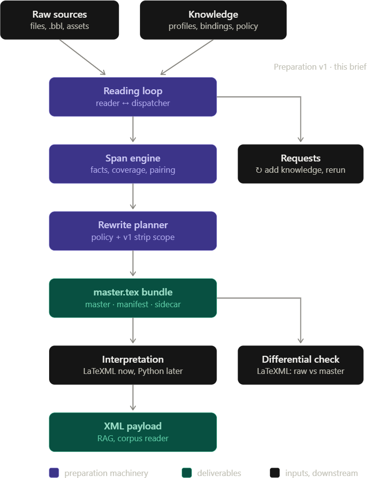

# `codex-scientiae` - "Bound knowledge"

**WIP**

`codex-scientiae` is a Pythonic repository dedicated to the procurement, husbandry, and compilation of contemporary research-grade technical manuscripts sourced from the web The long-term goal to generate on-demand context payloads for agents and RAG applications.

## Core Pillars

### `jsonl_engine`

... and client for creating metadata store inventories of collected documents in various forms. Written in Python.

Features

- Atomic writes
- Schema validation
- ... and more

### `batch-executor`

... and client for implementing a generic, configurable Powershell runspace manager and batch execution engine for parallel processing on a local machine.

Features

- Reusable/Configurable Powershell Runspace Manager
- Process or Runspace-level concurrency
- Graded dispatch and smart allocation
- Cancellation and fault tolerance
- Structured results
- ... and more

### `procurement`

... and associated agentic MCP services + skills to enable interactive literature research and acquisition via integrated API providers such as arXiv and Zenodo as well as aggregators such as CrossRef and Semantic Scholar. Written in Python.

Features

- Automated backoff for rate-limited APIs
- Shared abstraction over multiple provider APIs
- Agent MCP and skills for on-the-fly acquisitions
- ...and more

### `supellex`

Collected materials, mainly from arXiv, organized by topics and directory path conventions including different format versions of each article when available to support dev testing and benchmarking during development of the TBD document processing applications for PDF and Latex.

## Coming soon

### `texml-compiler`

A modern python adaptation of the LaTeXML project that will implement stateful latex emulation and deterministically compile raw LaTeX source payloads into a canonical designer XML intermediate form for downstream applications with specific focus on high-fidelity capture of mathematical, algorithmic and quantitative content and rich XML representations designed for flexible but accurate projections to different renderings, formats and spellings.

### Later

#### `pdf_decompiler`

A pdf-to-XML extraction pipeline targeting the same XML IR that will be developed with a stabilized `texml_compiler` as a verified baseline for dev cycle validation and regression testing via batched `gauntlet` runs. May involve judicious application of agents or sub-agent swarms for semantic resolution and structural repair.

#### `xml_scholar_mcp`

An MCP server that will be designed to mount collections of the XML IR emitted by the above two initiatives and which will optimize for token efficiency, context-hygiene, etc.
